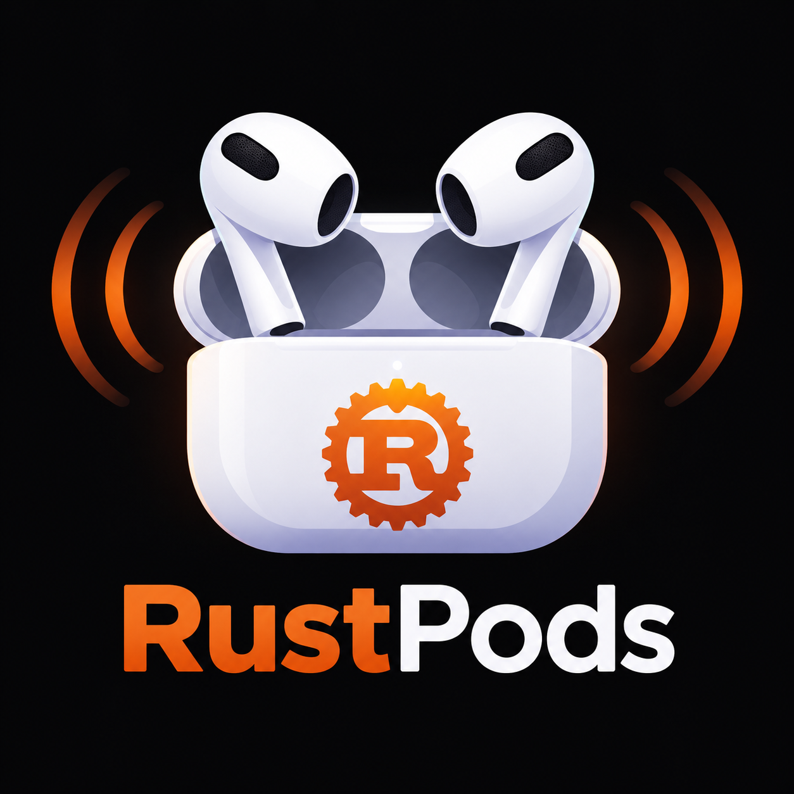

<p align="center">
  
</p>

<h1 align="center">RustPods</h1>

<p align="center">
  <strong>AirPods control center and system service for Linux.</strong><br>
  Native Rust, GPU-accelerated UI, head-tracked spatial audio, and a pointer you drive with your head.
</p>

<p align="center">
  <strong>English</strong> · <a href="README_zh.md">简体中文</a>
</p>

<p align="center">
  <a href="LICENSE"></a>
  
  
  <a href="https://github.com/windosx/rustpods/issues"></a>
</p>

---

RustPods brings the parts of the AirPods experience that macOS takes for granted to Linux: battery and ear-detection status, noise control, a real control-center UI, and — with head tracking enabled — spatial audio that stays anchored in space and a pointer you can move by turning your head.

It speaks Apple's AACP protocol over L2CAP directly from Rust. No bridge daemon, no patched BlueZ, no Android phone in the middle.

> [!NOTE]
> RustPods is early-stage software (v0.2.3). Head tracking has been verified end-to-end on AirPods 3 through Apple RemoteHID; newer models use the documented payload layouts in `src/core/head_tracking.rs`. Expect rough edges, and please [open an issue](https://github.com/windosx/rustpods/issues) when you find one.

## Features

### Apple-style control center

- GPU-rendered with [GPUI](https://crates.io/crates/gpui-kit): rounded cards, translucent surfaces, and instant light/dark switching.
- Six pages: **Overview**, **Spatial Audio**, **Head Mouse**, **Controls & Gestures**, **AI Agents**, and **Preferences**.
- Overview shows the device render, inline rename, connection state, and separate ring gauges for each bud and the case.
- Per-model capability detection: controls that the connected AirPods cannot support stay hidden instead of failing silently.

### Head-pose mouse

- 120 Hz motion engine: angular velocity drives the cursor, so the pointer glides while you turn and stops the moment your head does.
- 1-Euro adaptive filter: heavy smoothing at rest, low latency during fast turns.
- Soft dead zone plus a non-linear acceleration curve: small movements for small targets, fast sweeps across multiple monitors.
- Relative **Air Mouse** and absolute **Laser Pointer** modes, plus a scroll mode that maps pitch to the wheel.
- Gestures: single/double/triple stem pinch, long-press to pause, roll-to-click, and optional dwell click.
- One-click authorization through Polkit when `/dev/uinput` is not yet writable by the user.

### Head-tracked spatial audio (PipeWire + SOFA)

- A true stereo loudspeaker stage at ±30°, following ITU-R BS.775, rendered by two independent SOFA spatializers (`spatL` / `spatR`).
- Yaw, pitch, and roll are projected into head coordinates and written atomically to the PipeWire filter-chain.
- 5° perceptual quantization and a 50 ms rebuild throttle keep a 100 Hz sensor stream from saturating the CPU.
- The HRTF stage is passive and follows the current default sink; applications are routed to it per stream, not by changing the system default.

### Gesture approval for AI agent permissions

- When an agent such as ZCode or Codex requests permission for sensitive tools (such as `Bash` commands, `write_file`/`edit_file`), a `PreToolUse` hook forwards the request to RustPods.
- **Nod to allow**; **shake your head to deny**; a timeout or closing falls back to the native terminal prompt.
- A hysteresis state machine with an adaptive rest baseline keeps recognition reliable when lying down or reading.
- The permission request appears in a dedicated floating card (Wayland layer shell / X11 override-redirect window) supporting both head gestures and clicks.

### Lid-open popup and tray

- BLE proximity monitoring detects the case lid opening and shows an iOS-style card with the matching 360° device animation and live battery levels.
- A Freedesktop StatusNotifierItem tray icon (`ksni`) works on Waybar, Niri, Hyprland, Sway, GNOME, and KDE.
- The tray ring shows the current bud battery: red when low, green with a lightning badge while charging.
- Right-click for live battery status, noise-mode switching, and opening the main window.

> [!TIP]
> **Eliminate BLE scan interference with Bluetooth mice & keyboards (BLE HID)**:
> By default, generic active discovery scans continuously across the radio band. If you use BLE keyboards or mice, you can enable BlueZ's hardware offloaded pattern monitoring (`AdvertisementMonitor`, similar to macOS, where the Linux kernel and Bluetooth controller filter Apple packets in hardware without continuous generic discovery):
> ```bash
> sudo sed -i 's/#Experimental = false/Experimental = true/' /etc/bluetooth/main.conf
> sudo systemctl restart bluetooth
> ```
> Once enabled, RustPods automatically uses `AdvertisementMonitor`, eliminating RF channel contention and reconnection latency for wireless peripherals while ensuring instant lid-open popups.

### Native AACP stack

- Pure Rust classic-Bluetooth L2CAP channel on PSM `0x1001` via `bluer` on Linux.
- Announces all sensor descriptors (`request_all_descriptors`) and brings up Apple RemoteHID (`0x800`) at roughly 100 Hz.
- Ear detection (pause on removal, resume on insertion) and Conversational Awareness are driven from decoded AACP notifications.
- AES-128 payload decryption and RPA hash validation live in `src/core/crypto.rs`.

## Device compatibility

RustPods recognises AirPods 1–4, AirPods 4 (ANC), AirPods Pro 1/2 (Lightning and USB-C), and AirPods Max (Lightning and USB-C), and exposes only the controls each model actually implements.

| Capability | Models |
| --- | --- |
| Battery, ear detection, model detection | Full lineup |
| Noise control, transparency, adaptive audio | Models that expose it (e.g. AirPods Pro 2, AirPods 4 ANC, AirPods Max) |
| Conversational Awareness | AirPods Pro 2, AirPods 4 ANC |
| Head tracking | AirPods 3 via RemoteHID (`0x800`), verified end-to-end; AirPods 4 payload layout implemented |

## Requirements

- Linux with a running **BlueZ** stack (>= 5.60) and a Bluetooth adapter that supports classic Bluetooth.
- **Rust 1.85+** (the crate uses edition 2024).
- **PipeWire** for head-tracked audio, with the SOFA filter-chain module:
  - Fedora: `sudo dnf install pipewire-module-filter-chain-sofa`
  - Debian/Ubuntu: `sudo apt install libpipewire-0.3-modules`
- **`/dev/uinput`** access for the head-pose mouse. RustPods can request it through Polkit.
- Build dependencies: `clang` / `libclang`, `pkg-config`, and the PipeWire headers.
  - Fedora: `sudo dnf install clang pipewire-devel pkg-config`
  - Debian/Ubuntu: `sudo apt install clang libclang-dev libpipewire-0.3-dev pkg-config`

`audio-follow` is a default Cargo feature because it pulls in `pipewire-sys` and therefore the headers above. To build without PipeWire:

```bash
cargo build --release --no-default-features
```

The GUI, tray, AACP stack, and head-pose mouse work either way; only the spatial audio filter-chain follower is omitted.

## Installation

### Method 1: Package Managers & Prebuilt Releases (Recommended)

#### Arch Linux (AUR)
```bash
yay -S rustpods-bin   # Prebuilt binary package (recommended, fast)
# Or build from source:
yay -S rustpods
```

#### Debian / Ubuntu (.deb)
Download the latest `.deb` package from [Releases](https://github.com/windosx/rustpods/releases):
```bash
sudo apt install ./rustpods_*_amd64.deb
```

#### Fedora / openSUSE (.rpm)
Download the latest `.rpm` package from [Releases](https://github.com/windosx/rustpods/releases):
```bash
sudo dnf install ./rustpods-*.x86_64.rpm
```

#### Universal Release Tarball
Download `rustpods-v*-linux-x86_64.tar.gz` from [Releases](https://github.com/windosx/rustpods/releases):
```bash
tar -xzf rustpods-v*-linux-x86_64.tar.gz
cd rustpods-v*-linux-x86_64
sudo ./install.sh        # System-wide install (recommended: configures udev & systemd)
# Or install to ~/.local without root:
./install.sh             # Installs to ~/.local
```

### Method 2: Build and Install from Source

```bash
git clone https://github.com/windosx/rustpods.git
cd rustpods
cargo build --release

# Install system-wide or to ~/.local using the installer:
sudo ./contrib/scripts/install.sh   # Installs to /usr/local
# Or
./contrib/scripts/install.sh        # Installs to ~/.local
```

> [!TIP]
> **Passwordless Head Mouse Permission**: Installing via a package manager or `sudo ./install.sh` automatically installs `/etc/udev/rules.d/70-rustpods.rules`, granting the active desktop user access to `/dev/uinput` via systemd `uaccess`. You won't be prompted for root or Polkit authentication when activating the Head Mouse.

### Background Daemon & Autostart (systemd)

RustPods provides a systemd user service unit. After installation, enable the background tray daemon with:

```bash
systemctl --user enable --now rustpods
```

### Checking for Updates & Updater

- **GUI**: Navigate to **Preferences** -> **About & Version**, and click **Check for Updates**;
- **CLI Check**:
  ```bash
  rustpods --check-update
  ```
- **In-place Online Upgrade** (for Tarball / manual script users):
  ```bash
  curl -fsSL https://raw.githubusercontent.com/windosx/rustpods/master/contrib/scripts/update.sh | bash
  # Or run the built-in update command:
  rustpods --update
  ```
  > [!NOTE]
  > If your installation is managed by a system package manager (AUR / DEB / RPM), RustPods protects system package database integrity by prompting you to update via your package manager (e.g. `yay -S rustpods-bin`) instead of overwriting files in `/usr/bin`.

To uninstall, run `sudo ./uninstall.sh` (or `contrib/scripts/uninstall.sh`).

## Usage

```bash
rustpods                  # open the control center
rustpods --minimized      # start minimized to the system tray (autostart)
rustpods --no-gui         # tray-only daemon (good for autostart)
rustpods --debug          # verbose logging
rustpods --log-file PATH  # also write logs to a file
```

Launching the GUI a second time activates the existing window instead of starting a second engine. All AACP modes share one per-session lock because two engines make the accessory stop answering.

### Head-pose mouse quick start

1. Open **Head Mouse** in the sidebar.
2. Enable the switch. If `/dev/uinput` is not writable, a Polkit dialog appears; authenticate once and the driver starts.
3. Useful gestures:
   - Keep **Air Mouse** mode for everyday use: small head movements move the pointer precisely.
   - Long-press either stem to pause or resume control while you talk or look away.
   - Triple-pinch to toggle scroll mode, then pitch your head up or down to scroll long pages.

### Head-tracked spatial audio

1. Download a SOFA dataset (for example the SADIE II Neumann KU100 set, or MIT KEMAR) and place it in a stable directory:

   ```bash
   mkdir -p ~/.local/share/rustpods/sofa
   # copy e.g. D1_48K_24bit_256tap_FIR_SOFA.sofa here
   ```

2. Install the filter-chain configuration:

   ```bash
   mkdir -p ~/.config/pipewire/pipewire.conf.d
   cp contrib/pipewire/99-rustpods-hrtf.conf ~/.config/pipewire/pipewire.conf.d/
   ```

3. Edit the copied file and set **both** `filename` values to the absolute path of your SOFA file. PipeWire does not expand `~`, and a relative path fails silently.

4. Restart PipeWire and open the **Spatial Audio** page:

   ```bash
   systemctl --user restart pipewire
   ```

5. Route the streams you want spatialized to **RustPods Head-Tracked Stereo** (for example in `pavucontrol`'s Playback tab or with `pw-link`). Do **not** set it as the system default sink: the HRTF playback stream is passive and follows your real default output, which keeps volume keys and other desktop behaviour attached to the physical device.

### AI agent gesture permission approval

The **AI Agents** page installs the ZCode / Codex `PreToolUse` hook and shows its status. Once installed, sensitive tool execution requests appear in a floating card; nod to allow, shake to deny, or let the timeout return control to the terminal. The hook talks to RustPods over a Unix socket and always falls back to the native prompt if the service is not running.

## Architecture

```text
rustpods/
├── Cargo.toml
├── LICENSE
├── NOTICE                         # third-party attribution
├── README.md                      # this file
├── README_zh.md                   # 简体中文
├── contrib/
│   ├── io.github.rustpods.RustPods.desktop
│   └── pipewire/99-rustpods-hrtf.conf
├── assets/                        # banner, icons, 360° device animations
└── src/
    ├── main.rs                    # entry point, CLI, Tokio runtime, instance lock
    ├── core/                      # Bluetooth protocol and sensor math
    │   ├── aacp/
    │   │   ├── commands.rs        # noise mode, microphone preference, adaptive level
    │   │   ├── events.rs          # battery, ear detection, stem presses
    │   │   ├── packets.rs         # AACP framing and opcode dispatch
    │   │   ├── remotehid.rs       # Apple RemoteHID on descriptor 0x800
    │   │   ├── rtbuddy.rs         # RTBuddy sensor announcement and sample-rate negotiation
    │   │   └── mod.rs             # AacpManager connection lifecycle and event fan-out
    │   ├── head_tracking.rs       # orientation integration, gravity frame, gyro bias
    │   ├── nod_counter.rs         # nod gesture state machine
    │   ├── spatial.rs             # spatial audio session state
    │   ├── models.rs              # AirPods model and capability matrix
    │   ├── device.rs              # reactive device state
    │   └── crypto.rs              # AES-128 decryption and RPA hash validation
    ├── system/                    # desktop integration and device drivers
    │   ├── head_mouse/
    │   │   ├── one_euro.rs        # 1-Euro adaptive filter
    │   │   ├── engine.rs          # dead zone, acceleration curve, gesture clicks
    │   │   ├── uinput.rs          # /dev/uinput driver and Polkit authorization
    │   │   ├── controller.rs      # 120 Hz control loop
    │   │   └── mod.rs
    │   ├── audio_follow.rs        # PipeWire azimuth/elevation updates
    │   ├── bluetooth.rs           # BlueZ adapter management and auto-connect
    │   ├── le_monitor.rs          # BLE proximity lid-open monitoring
    │   ├── agent_hooks.rs         # agent hook registry
    │   ├── zcode_ask.rs           # ZCode AskUserQuestion Unix-socket service
    │   ├── mpris.rs               # MPRIS media control
    │   ├── tray.rs                # StatusNotifierItem tray
    │   └── config.rs              # atomic config persistence
    └── ui/                        # GPUI interface
        ├── components/            # Overview, battery, noise, head mouse, etc.
        ├── ask_popup.rs           # agent question floating card
        ├── popup.rs               # lid-open 360° animation popup
        ├── theme.rs               # Apple control-center palette
        ├── state.rs               # reactive state bus
        ├── window.rs              # sidebar navigation and page assembly
        └── mod.rs                 # GPUI application lifecycle
```

## Testing

```bash
cargo test
```

The suite covers AACP framing and dispatch, AES-128 decryption, attitude integration and gyro bias estimation, the 1-Euro filter, dead-zone and gesture math, configuration migration, and model capability mapping.

Before sending a pull request, please also run:

```bash
cargo clippy --all-targets
```

## Contributing

Issues and pull requests are welcome. For protocol or head-tracking changes, please include the AirPods model and firmware version you tested with, and a log or capture where possible. Head-tracking behaviour differs between models and firmware releases, so a change that works on one pair is not automatically safe for the rest of the lineup.

## Acknowledgements

RustPods builds on the work of earlier reverse engineers and open-source projects:

- **[LibrePods](https://github.com/kavishdevar/librepods)** (AGPL-3.0) — AACP command and event encoding, the L2CAP transport model, and gesture detection. RustPods' gesture detector is a port of LibrePods' `GestureDetector`.
- **[MousePods](https://github.com/starman-tech/mousepods)** by Matteo Gaudioso ([@starman-tech](https://github.com/starman-tech)), Apache-2.0 — the first public documentation of Apple RemoteHID (HID over AACP), plus the `MotionEngine` head-pose math and head-mouse dynamics that RustPods' implementation follows. **If you build on this work, tell the author: open an issue or mention @starman-tech.** For academic use, cite MousePods through its [CITATION.cff](https://github.com/starman-tech/mousepods/blob/main/CITATION.cff). RustPods' own notification is [starman-tech/mousepods#20](https://github.com/starman-tech/mousepods/issues/20).
- **[anilsrml/airpods-posture](https://github.com/anilsrml/airpods-posture)** — sensor payload layout for newer AirPods firmware, including the marker-relative offsets used for AirPods 4.
- **[SpriteOvO/AirPodsDesktop](https://github.com/SpriteOvO/AirPodsDesktop)** (GPL-3.0) — the 360° AirPods animations under `assets/animations` are derived from its chroma-keyed animation assets.

See [NOTICE](NOTICE) for the full third-party attribution and license details.

## License

RustPods is released under the **[GNU Affero General Public License v3.0](LICENSE)**.

Third-party work retains its original license:

- MousePods — Apache-2.0, Copyright Matteo Gaudioso.
- AirPodsDesktop animation assets — GPL-3.0.

---

AirPods, macOS, and Safari are trademarks of Apple Inc., registered in the U.S. and other countries. RustPods is an independent community project and is not affiliated with, endorsed by, or sponsored by Apple Inc.